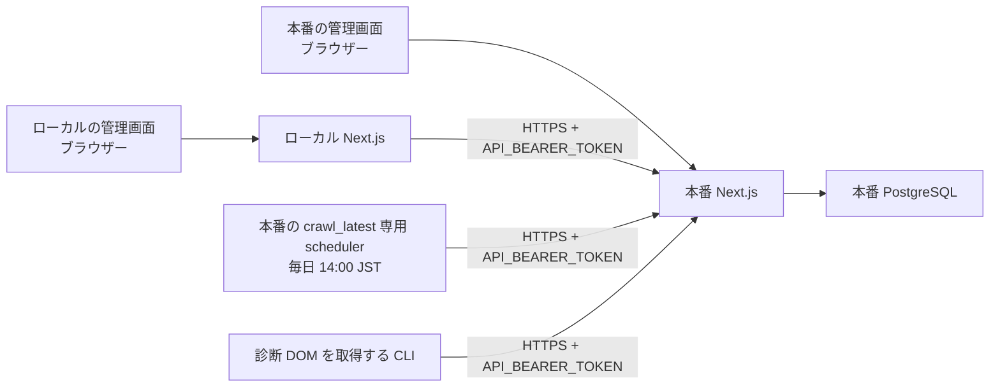
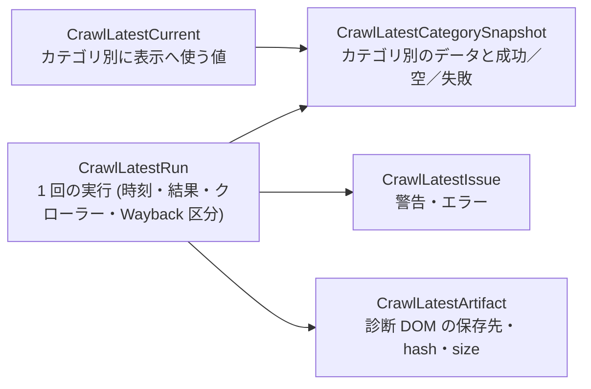

# バックエンドとクローラーのデータ管理

旧称・ふりがなは `SkiResortRubySegment` / `SkiResortFormerName` の専用テーブルに保存する．
スキー場 ID と表示順を複合主キーとし，文字・読みを個別の文字列列に格納する．旧称とその読みには検索用 index を持つ．
読みの確認状態だけは `SkiResort.readingNeedsReview` に保存する．
`20260906120000_add_resort_readings` で 506 件の辞書スナップショットを既存 ID へ一度だけ移行する．
公開・検索・管理画面は DB/API の値を使用し，空欄にしても元の JSON へ戻らない．

レビュー公開は `PUT /api/admin/reviews` で受け付ける．
管理画面の取り込みと CLI は共通の構造検証を通し，detail/article の両方を expectedHash 付きで一括保存する．
CLI は接続先・入力内容・確認時の本番 hash をプランに保持し，変更を検出したら再確認を求める．
操作方法は[日常のデータ編集・レビュー公開手順](d0008_content-publishing-guide.md)を参照．


## 正本と永続化

本番 PostgreSQL を正本とする．永続データは配備ごとに交換するアプリコンテナから分離する．

実際のローカル復旧，本番移行，API 接続，クローラー運用の順序は
[`d0005_backend-migration-runbook.md`](d0005_backend-migration-runbook.md) を参照する．

- アプリのプログラム: 交換可能な `app` コンテナ
- スキー場情報，編集した JSON/GeoJSON，クロール結果: PostgreSQL の永続 volume
- 警告・失敗時の DOM: 非公開の永続 volume (将来は object storage へ移行可能)
- クローラーとアプリのコード: GitHub

Docker を使うことと，DB を永久に残すことは両立する．コンテナはプログラムを動かす箱，volume は箱を交換しても残る保管場所である．

## 通信の流れ



API トークン `API_BEARER_TOKEN` はサーバー専用の `.env.local` や `.env` に置き，Next.js のサーバー側や対象 CLI だけが読む．ブラウザー向けの公開設定には含めない．人の操作ではセッションと現在の DB 権限を確認する．Web，データ API，worker は対応する版を同時に配備する．

| 利用経路 | データを読む場所とアクセス条件 |
| --- | --- |
| 一覧，施設の共有 URL，投稿詳細・一覧・写真一覧，プロフィール | Server Components が共有サービスを呼ぶ．公開ページに本人情報を含む場合はリクエストごとに現在の閲覧者を解決する |
| 地図で選んだ施設，料金，リンク，推薦，条件変更後の投稿一覧，情報修正の対象 | Route Handlers が共有サービスを呼ぶ．情報修正の対象は公開中の施設に限定し，原本から編集に必要な項目を抽出する |
| お気に入り，比較リスト，通知，滑走記録 | セッションから本人を解決し，取得と更新を本人で絞る．お気に入りと比較リストでは，画面のアカウントと現在のセッションが異なる要求も拒否する．共通の地図を保存する HTML には本人のデータを含めない |
| 投稿・情報修正，編集と承認 | Server Actions と専用の HTTP 入口が，共有サービスに本人または匿名の証明を渡す．写真付き投稿は multipart の受信量を検査する．管理操作では現在の DB 権限を確認する |
| 管理画面の初期表示と施設切替 | 初期表示は Server Components から取得する．施設切替後は `/api/admin/editor/queries` が現在の DB 編集権限を確認する |
| worker・CLI，別環境の正本への接続 | `/api/admin` の機械用入口が Bearer token を検証する．人による操作を中継する場合は接続先でも actor を照合する |

JSON API のエラーは `application/problem+json` で返し，呼び出し元は HTTP status と `code` で失敗を識別する．写真の秘匿 404 と成功応答には `private, no-store` を付ける．

ツアー収集の名寄せは `GET /api/admin/resorts?view=tour-matching` を使う．公開中の施設の ID，施設名，短縮名，旧称，都道府県を返す．

地図と外部リンクへの中継は現在の公開施設 ID を照合する．料金と施設リンクの資料 ID は，公開中の統合先への紐付きも照合する．詳細と比較の料金は `POST /api/resorts/ticket-plans` で施設と条件を渡して計算する．通信が切れた端末では，保存済みの公開料金表に同じ計算を適用する．

単独の投稿一覧とコミュニティ設定ページの初期データは Server Components が取得する．画面内で開くダイアログと投稿後の再取得には既存のコミュニティ API を使う．

比較詳細と地図配信は，同じサーバープロセス内で同じスキー場の地図を続けて読む場合がある．canonical map の本文応答には，同じ `RepeatableRead` 内で取得した地図文書の hash/version と採用中の営業 snapshot ID から作った revision を含める．次の読み込みでは `GET /api/admin/maps/resorts?resortId=<id>&view=revision` で revision のみを照合し，一致する場合だけ地図を再利用する．canonical map が無効な環境では既存の legacy loader を毎回使い，地図 cache は作らない．管理編集の capture 中も cache を迂回する．保持数は最大 32 件で，revision が変われば読み直す．

## Chrome からデータが見える範囲

画面に描画するためブラウザーへ送ったデータは，API でも Server Actions でも利用者が確認できる．Server Actions は「JSONを絶対に見えなくする仕組み」ではない．

そのため次の境界にする．

- 診断 DOM，管理用の元 JSON，管理情報は一般利用者のブラウザーへ送らない．
  管理者が編集に使う情報は認証済みの管理画面へだけ渡す．
- 一般画面には必要な項目を列挙した公開データだけを返す．スキー場の DB 問い合わせと
  remote API 応答は同じ公開項目一覧を使い，DB や管理画面に新しい列を追加しても自動公開しない．
- 料金は内側の項目も含めて公開対象を列挙する．料金計算に必要な営業時間と出典 URL・タイトルは
  維持し，資料のローカルパス，調査担当への申し送り，未知の管理フィールドは送らない．
- 詳細画面には公開用に選んだ天気・積雪と営業情報を含める．管理用の元データと内部の作成・更新時刻は返却対象から除外する．
- 管理用 API はトークン，管理画面の変更は Auth.js の管理者権限で毎回確認する．
- コース線の座標のように，ブラウザー上で地図を描画するため必要な値は完全に秘匿できない．生ファイルと不要な属性を送らないことで露出範囲を減らす．

## `crawl_latest` の DB 保存

クロール 1 回を上書きせず履歴として保存し，コース・リフト・天気・コメントごとに「現在採用中の正常値」を指す．



送信内容の全体コピー (rawPayload) は保存しない．受信時の検証だけに使う．

カテゴリごとの扱い:

| 結果 | 条件 | 表示 | 現在値 |
|---|---|---|---|
| 成功 | ページを開けて値を読めた | 値と出典 | 置き換える |
| 不明 | ページは開けたが状態を読めない (`status: null`) | 「不明」と出典 | 置き換える (警告と DOM を残す) |
| 掲載なし | ページは開けたが表・欄がない (`EMPTY`) | コース・リフトは「不明」と出典，天気・コメントは欄ごと出さない | 置き換える (DOM を残す) |
| 失敗 | ページを開けない，エラー，件数の想定違い，名前の重複・空・想定外の記号 | 出さない | `CRAWL_LATEST_STALE_AFTER_HOURS` (既定 0) を過ぎたら外す |

クローラーの警告は表示を止めない．止めるのはエラーと `blocksPromotion: true` の警告だけ．
コースかリフトが 1 件以上あり全部×の実行では，天気・コメントの警告とそのためだけの DOM を
残さない．コメントを取れなかった回はコメントの出典を付けない．Wayback 検証の値は履歴に
残すが，本番表示の現在値にはしない．公開画面では Git 管理の過去の取得結果 (`latest_data/`)
で補わない (管理画面の名称対応だけが候補として読む)．

TODO (クロールを 1 日 30 回程度に増やすとき):
- 中身の `contentHash` が直前の採用 snapshot と同じなら，snapshot の `data` を重複保存しない．
  その場合も「失敗が続いたら表示しない」判定が使えるよう，`CrawlLatestCurrent` に
  同じ内容を最後に確認した時刻を持たせる．
- 履歴 (run・snapshot・issue・artifact) は現状削除しない．容量が問題になったら，
  現在値が参照する snapshot と Wayback 検証の run を除いて古いものを消す．

同じクローラーコードは，保存先を明示してローカルでも実行できる．

```bash
# API設定を意図的に無効化し、ローカルファイルへ保存する
mise run crawl:latest -- --local-files --resort rusutsu-resort

# API_BASE_URLの本番APIへ送る（専用環境だけで使う）
mise run crawl:latest -- --remote-api --resort rusutsu-resort
```

ローカルファイルモードの正常結果は
`src/private/data/resorts-temporary/latest_data/<resort-id>/<日時>.json` に残る．警告があれば
正常結果と混ぜず，通常は
`src/private/data/resorts-temporary/crawl_latest_dom/<resort-id>/` 以下に生結果，警告理由，
レンダリング済み DOM を隔離する．このため，コード変更時は VS Code 上で結果と公式 DOM を並べて
確認できる．この JSON は
ローカル検証用であり，GitHub 経由で本番値にするものではない．本番への反映は remote API 経由に
限定する．

## 管理画面で編集する JSON/GeoJSON

リフト券，レビュー，コース，リフト，対応表，参考リンクなどの運用データは，
PostgreSQL の `DataDocument` に保存する．従来ファイルの相対パスをキーにし，JSON 本体，
hash，version を持つ．Git 側のファイルは初回投入元または開発用 fixture として残す．

- 本番 Next.js は本番 DB を直接使う．`API_BASE_URL` を設定したローカル Next.js は，
  同じ本番データを内部 API から読み書きし，本番 DB へ直接接続しない．
- DB に文書がなければ欠損として扱う．通常運用では Git ファイルへの実行時 fallback はない．
  公開用の最新状況も `CrawlLatestCurrent` を使い，ローカルの検証 JSON へ戻らない．
- 2 人が同じ文書を編集した場合は hash で競合を検出し，後から保存した人へ再読込を案内する．
  スキー場マスターは `updatedAt` を比較し，どちらも無言で上書きしない．
- 関連する文書は transaction でまとめて保存する．コース・リフトでは公開画面用の派生情報も
  更新し，元の `slope_10m` 文書をそのままブラウザーへ送らない．
- 保存・初回投入時に，安全なキー，UTF-8 のサイズ，JSON/GeoJSON の形式，hash を検証する．

### 初回投入と通常起動の分離

初回投入は `--initialize` を指定した明示処理である．全ファイルを検証した後，未登録文書の
追加と `CanonicalDataMigration` の完了記録を同じ transaction で確定する．既存の admin 編集は
保持し，失敗すれば追加と完了記録をともに取り消す．

完了記録は `canonical-documents-v1` と `ski-resort-short-names-v1` の 2 種類である．
同じ処理を再実行しても完了済みなら書き込まない．文書を削除しても完了記録は残るため，
次回 deploy や再実行で Git 版が復活しない．通常のコンテナ起動と `mise run setup` は
初回投入を実行しない．

```bash
# ファイルの形式・件数・hashを検証する。DBへの接続も書込みもない。
mise run db:import-documents -- --dry-run
mise run db:import-short-names -- --dry-run

# バックアップ後、正本サーバーの初回移行で明示する処理
node --import tsx scripts/importCanonicalDataDocuments.ts --initialize
node --import tsx scripts/importSkiResortShortNames.ts --initialize
```

本番コンテナ内だけに存在する JSON/GeoJSON はない．旧コンテナから JSON をコピーしたり，
ローカル版と突き合わせたりする移行作業は不要である．

空の DB にスキー場マスターを再構築する古いクローラーは実行しない．必要な環境では
DB バックアップを復元して基本情報を確保する．文書投入は基本情報が空なら停止し，
短縮名投入は対応するスキー場 ID がなければ全件停止する．復旧も完了記録を消して Git 版を
一括再投入せず，DB バックアップの復元または必要な文書を選んだ admin での復元を使う．

開発専用の例外として `DATA_DOCUMENT_ALLOW_BUNDLED_FIXTURES=true` を指定すると，
初回投入前の開発 DB に限って同梱 fixture を読む．本番環境と完了記録のある DB では無効である．
ローカル DB は使い捨ての検証・認証用に置くことができるが，別の運用正本にはしない．

### 地図・比較の短縮名

短縮表示名は `SkiResort.shortName` に保存する．`SkiResortNameAliases.json` の 113 件は
初回投入元であり，実行時やクライアントからは import しない．初回は未設定の値だけを設定し，
以後は `/admin/resort` から編集する．未設定なら既存の正式名を使い，地図ラベルでは
従来どおり「スキー場」の文字を省く．

短縮名は公開情報であり秘匿対象ではない．旧称や外部サイトの複数の別名が将来必要なら，
`shortName` に詰め込まず別の `SkiResortAlias` テーブル等で扱う．閉鎖・廃止した施設も削除せず，
`isActive=false` で公開一覧・詳細から除外する．admin では確認・再有効化できる．

## 営業状況の検証

固定件数の一致ではなく，使用中の対応表から営業状況を一意に埋められるかを検証する．
欠損・曖昧さは項目ごとに不明とし，取得できた正常項目の採用は止めない．
保存時に反映・集計し，表示時は snapshot ID の一致だけを確認する．
処理と掲載形式の例外一覧は [営業状況の対応表検証](d0012_crawler-operation-coverage.md) を参照．

## DOM の保存

正常かつ無警告の DOM は保存しない．次のどれかが起きた実行だけ保存する．

- ページ取得や必須 selector が失敗した
- 必須の名前や状態がない
- 辞書にない状態文字列が来た
- 対応表で参照する営業項目の欠損・状態不明，重複，URL，値の範囲などの検証で警告が出た
- クローラー自身が `console.warn` または `console.error` を出した

DOM 本体は大きなバイナリデータと同じ扱いとし，PostgreSQL には本体ではなく「どのスキー場で、いつ、なぜ、どこに保存したか」と hash・size を記録する．これにより DB のバックアップを DOM で肥大化させない．

Codex や Claude Code で調査するときは，本番 volume へ直接入る必要はない．内部 API 経由で
必要な DOM だけ，Git 管理外のローカルフォルダーへ取得できる．

```bash
mise run crawl:diagnostics:pull -- --resort <ski-resort-id>
# または
mise run crawl:diagnostics:pull -- --run-id <crawl-run-id>
```

保存先は
`src/private/data/resorts-temporary/crawl_latest_dom/remote/` である．取得後は VS Code 上で
DOM とクローラーコードを並べて確認・修正できる．

### 診断 DOM の保存期間と自動整理

DOM の保持期間は既定 30 日で，`CRAWLER_ARTIFACT_RETENTION_DAYS` で変更する．
アップロード後などの整理時に期限を過ぎた DOM 参照を外し，run・issue・hash 等の履歴は保持する．
整理は取込みに伴って動くため，30 日を過ぎた瞬間に全ファイルが消える意味ではない．

DB から参照されなくなった gzip は，最終更新から 24 時間以上経過したものだけを削除する．
削除直前にも参照を確認し，新規アップロードや参照中のファイルを保護する．
整理は 1 時間に最大 1 回で，PostgreSQL のロックにより重複実行を避ける．
Cookie，Authorization，API key，フォーム値等は DOM 保存前に除去し，正常・無警告時には保存しない．

`crawler_artifacts` は DB とは別の volume である．重要な調査中 DOM は期限前に診断 API で取得し，
必要に応じて別途暗号化して保管する．DB バックアップだけでは DOM 本体を復元できない．

## 定期実行するクローラー

「コードを残すこと」と「自動で動かすこと」は別である．

- 従来のクローラー本体と `mise run crawl:*`，`crawl:all` は削除せず，必要時に手動実行
  できる状態で残す．
- アプリ内の従来スケジューラーが自動実行するのは，毎日 03:00 (JST) の
  `crawlYukiMagi.ts` だけにする．コンテナ起動直後には実行しない．
- 複数コンテナが同時に 03:00 を迎えても，PostgreSQL のロックで同じクローラーの重複実行を
  防ぐ．アプリが 03:00 に停止していた場合の再実行はしないため，将来複数台運用にするなら
  外部の単一 scheduler へ移す．
- 雪マジは取得・検証がすべて成功したときだけ DB を更新する．0 件，取得失敗，形式異常なら
  既存 DB を変更しない．
- 各スキー場の `crawl_latest` は別系統である．現在の 93 本は，本番デプロイで標準で `crawlers` profile を有効化した
  `crawl-latest-scheduler` コンテナが毎日 14:00 (JST) に実行し，結果を内部 API へ送る．
  scheduler は起動直後には実行せず，同日二重実行と前回バッチへの重複を避ける．
- 実行対象は `resorts/*.ts` から自動列挙し，`template.ts`，`*_before.ts`，テストファイルは
  除外する．現在 93 本だが，条件を満たすクローラーを追加すれば対象数も増える．

専用 scheduler にも `API_BASE_URL` と
`API_BEARER_TOKEN` を設定する．これにより正常結果は DB へ，警告・失敗 DOM は本番の
非公開 volume へ送られる．scheduler へ本番 DB の接続文字列は渡さない．日次 lock とバッチレポートは `crawler_worker_artifacts` volume へ保存する．

## GitHub に残すもの

- Next.js，DB schema，migration，クローラーのコード
- 名寄せ辞書，検証ルール，少数のテスト fixture
- 移行前の JSON の凍結アーカイブ

ここでいう名寄せ辞書は，同じ施設・コース・リフトが外部サイトとアプリで違う名前になって
いる場合の「名前の対応表」である．用途を混同しない．

- `SkiAreaNameDict.json` は，DB 上のスキー場名と雪マジ側の施設名を結ぶ．
- 各 `crawl_latest/resorts/*.ts` の `courseNameMap` / `liftNameMap` は，公式ページの名前を
  クローラーが出す統一名へ変換する．
- `latest_status_mapping` はクロール名と GeoJSON 上の線を結ぶ運用データであり，移行後は
  PostgreSQL の `DataDocument` が正本になる．
- `SkiResortNameAliases.json` は `SkiResort.shortName` への一度限りの投入元である．
- `SkiResortReadings.json` の旧称・ふりがなは専用テーブルへ移行済み．実行時の参照は DB へ統一し，管理画面で編集する．
- `SkiResortWeatherIds.json` は外部の天気サービスへのリンク生成に使う静的補助設定として残す．
- `src/private` は private crawler code，対応辞書，初回 fixture を保管する submodule として残す．
  commit する際は submodule 側の必要な変更を先に commit・push し，親の gitlink を更新する．

検証ルールは，名前・状態の欠落，`○`・`△`・`×` 以外の未知状態，重複，想定件数との差，
空カテゴリ，不正 URL，天気値の欠落や異常範囲などを検知するコードである．警告があるカテゴリを
正常な現在値へ昇格させず，前回の正常値を守るために Git でレビュー・変更履歴を管理する．

運用開始後の最新値や admin 編集を Git 側へ戻す必要はない．DB dump は認証情報も含む機密資料として扱い，Git や GitHub へ commit しない．

つまり GitHub が不要になるわけではない．GitHub はコード，DB の構造変更，初回投入用データ，
履歴の保管場所であり，PostgreSQL は運用中の最新データの保管場所になる．通常 deploy は初回投入を実行しない．初回の成功確認後は
`INITIALIZE_CANONICAL_DATA` を削除または false に戻す．

## 配備とバックアップ

GitHub の設定・配備・保持と復元の操作は [運用手順](d0005_backend-migration-runbook.md) を参照する．
本番アプリは DB に直接接続する．独立 scheduler は内部 API の URL とトークンで通信する．
ローカルのアプリを正本 API へ接続する場合も同じ設定名を使い，非 loopback の接続には HTTPS を使う．
